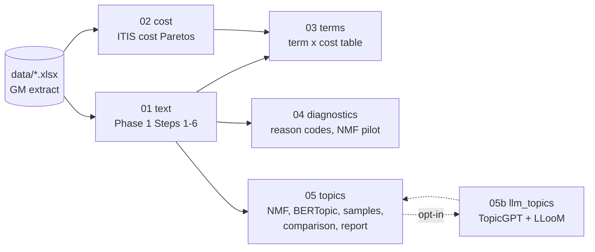

# GM ECR Analytics: Engineering Change Request text and cost pipeline

**IOE 424 Senior Design · University of Michigan · GM Case Study No. 6 · Cost Commandos Consulting**

This repository turns General Motors' Engineering Change Request (ECR) extract into every analysis the team
delivered: word-frequency Paretos of the free text, cost Paretos by assembly, VPPS code and part number,
a term-by-cost table, reason-code diagnostics, and a three-way comparison of topic models that groups ECRs
by **why** they were raised and **what** changed.

All of it runs from **one command**. Drop GM's workbook into `data/` and run `make`.

> **No data is in this repository.** The extract, `.env` credentials, model weights and every generated
> output are excluded by `.gitignore`. The tests and `make demo` use a synthetic extract with the same
> layout (`tools/synthetic_extract.py`).

---

## Contents

1. [Quick start](#1-quick-start)
2. [What the one button does](#2-what-the-one-button-does)
3. [Input data](#3-input-data)
4. [Stage by stage](#4-stage-by-stage)
5. [Outputs reference](#5-outputs-reference)
6. [Configuration](#6-configuration)
7. [LLM stages and data handling](#7-llm-stages-and-data-handling)
8. [Running on GM's own (unmasked) data](#8-running-on-gms-own-unmasked-data)
9. [Repository layout](#9-repository-layout)
10. [Testing, demo and reproducibility](#10-testing-demo-and-reproducibility)
11. [Notebooks](#11-notebooks)
12. [Troubleshooting](#12-troubleshooting)
13. [Method references](#13-method-references)

---

## 1. Quick start

**Requirements:** macOS or Linux, Python 3.10 or newer, `make`, and internet access the first time (to
install packages, the spaCy English model and the embedding model). About 3 GB of disk for the
environment (BERTopic pulls in PyTorch).

```bash
git clone https://github.com/maxwinnick/GM.git
cd GM
cp "/path/to/Masking_Lookup_Reference.xlsx" data/      # GM's extract (any name; see Section 3)
make                                                    # setup + model download + every stage
```

Results land in `outputs/`. Open `outputs/run_manifest.json` for a summary of the run, or go straight to:

| Start here | What it is |
|---|---|
| `outputs/01_text/phase1/Phase1_Steps1-8_Analysis.md` | Phase 1 text-model write-up with all figures |
| `outputs/02_cost_pareto/ITIS_Pareto_COST_USD.xlsx` | Every cost Pareto table, the cost reconciliation, the largest ECRs |
| `outputs/02_cost_pareto/charts/` | 75 slide-ready Pareto charts |
| `outputs/05_topics/Steps7-8_Analysis.md` | Three topic approaches side by side, per WO range |
| `outputs/05_topics/ecr_labels_all.csv` | One row per ECR with every approach's theme, for Power BI |

Other targets:

```bash
make help        # list targets
make test        # 18 tests on synthetic data, no network, about 1 minute
make demo        # whole pipeline on a synthetic extract -> outputs_demo/
make llm         # whole pipeline plus the TopicGPT / LLooM stage (needs .env; sends text to an LLM)
make BERTOPIC=0  # skip BERTopic and its 3 GB of dependencies; everything else still runs
make clean       # remove outputs, .venv and caches
```

Without `make`, the equivalent is:

```bash
python3 -m venv .venv && source .venv/bin/activate
pip install -r requirements.txt -r requirements-bertopic.txt
python -m spacy download en_core_web_sm
python tools/download_model.py
python run_pipeline.py
```

---

## 2. What the one button does

`make` runs four steps, each skipped if it is already done:

1. **Create `.venv`** and install `requirements.txt` and `requirements-bertopic.txt`.
2. **Download the spaCy model** `en_core_web_sm` (lemmatizer and person-name detection).
3. **Download the embedding model** for BERTopic and check its SHA256 (`tools/download_model.py`).
4. **Run `python run_pipeline.py`**, which executes every stage enabled in `config.yaml`, in order:



| # | Stage | Reads | Writes | Typical time (full extract) |
|---|---|---|---|---|
| 01 | `text` | extract | `outputs/01_text/` | ~3 min |
| 02 | `cost` | extract | `outputs/02_cost_pareto/` | ~1 min |
| 03 | `terms` | 01 + 02 | `outputs/03_term_frequency/` | seconds |
| 04 | `diagnostics` | extract + 01 | `outputs/04_diagnostics/` | ~1 min |
| 05 | `topics` | extract + 01 | `outputs/05_topics/` | ~5–15 min (BERTopic embedding dominates) |
| 05b | `llm_topics` | 05 samples | `outputs/05_topics/<partition>/approach3_llm/` | ~35–45 min, about 290 requests (off by default) |

Run part of it:

```bash
python run_pipeline.py --only cost                # one stage (repeat --only for several)
python run_pipeline.py --skip topics              # all enabled stages but one
python run_pipeline.py --input data/new.xlsx      # another extract
python run_pipeline.py --outputs runs/2026-12     # another output folder
python run_pipeline.py --states Closed            # Phase 1 text Paretos on Closed ECRs only
python run_pipeline.py --with-llm                 # add the llm_topics stage
python run_pipeline.py --help
```

A stage that needs an earlier stage's files stops with a message naming the stage to run first.

---

## 3. Input data

Put the extract in `data/`. The pipeline uses `input.workbook` from `config.yaml`
(`data/Masking_Lookup_Reference.xlsx`); if that file does not exist and `data/` holds exactly one `.xlsx`,
it uses that one. `--input` overrides both.

**Sheet `result`, one row per ECR (`WO_NO` must be unique).** Columns the code reads:

| Group | Columns |
|---|---|
| Keys and dimensions | `WO_NO`, `STATE`, `REASON`, `DRIVER`, `TYPE`, `SUBTYPE`, `CREATED_ON`, `VPPS`, `FNA_DESC`, `PART_NUMBER`, `NEW_PART_NUMBER`, `MASKED_LEAD_PROGRAM`, `MASKED_PROGRAMS`, `MASKED_SUPPLIER_NAME` |
| Free text (masked) | `MASKED_TITLE`, `MASKED_DESC_FOR_CHANGE`, `MASKED_REASON_FOR_CHANGE`, `MASKED_COST_COMMENT` |
| Cost | `COST`, `EXCHANGE_RATE`, `COST_USD` |

Optional: `data/Overall Process Flow.docx` (GM's field guide). It is only used as context for the LLM
stages; everything else runs without it.

**Two kinds of ECR.** WO numbers fall in two ranges. ECRs numbered 4.1M–4.8M carry a title (and usually
a cost comment) but no description or reason; ECRs numbered 7.0M+ carry all three. This is how the source
system recorded them, not missing data, so the topic stage fits every model separately for each range
(`partitions` in `config.yaml`).

---

## 4. Stage by stage

### 01 `text`: Phase 1 text frequency model (`ecr_text/`)

Implements the Phase 1 formulation from the mid-term report on the four masked text fields.

| Step | What it does | Code |
|---|---|---|
| Scrub | Replace identifiers that survived GM's masking (raw program codes, WO/ECR/PCCR numbers, part numbers, e-mails, phone numbers) with typed placeholders; spaCy `PERSON` names become `<PERSON>`. Leftovers are counted in the `Masking_Leaks` sheet. | `scrub.py` |
| 1. Lemmatize | Lowercase, split into statements (line breaks, `|`, `;`, sentence ends), drop tokens with digits, spaCy `en_core_web_sm` POS lemmatizer. Acronyms in `resources/acronym_glossary.csv` are kept verbatim; abbreviations in `resources/abbreviations.csv` are expanded only when `confirmed_by_gm = yes`. | `nlp.py` |
| 2. Stop words | spaCy's English list minus 15 kept words (negations and positions such as *no*, *not*, *front*, *side*) plus the domain list `resources/stopwords_domain.txt`. Every removal is counted. | `nlp.py` |
| 3. Counts | Document frequency per term (unigrams, bigrams, trigrams that never cross a statement), share, cumulative share, group share, lift and ubiquity across lead program, supplier and VPPS L1/L2/L3 (Eq. 1–5). | `phase1.py` |
| 4. Histograms | Words per ECR, per field, per group; rank-frequency (Zipf) plots. | `figures.py` |
| 5. Vocabulary | Terms in at least `min_df` ECRs (default 5). | `phase1.py` |
| 6. Term frequency | Sparse ECR × term count matrix (`tf_matrix.npz`) with its row and column index. | `phase1.py` |
| Report | Markdown write-up with every figure, literature basis and measured result, generated from the run. | `phase1_report.py` |
| Field Paretos | Per-field unigram/bigram/trigram Paretos (ABC classes), distinctive terms per group (weighted log-odds), Power BI long tables. | `pareto.py`, `report.py` |
| Optional LLM key terms | Up to 6 normalized key terms per text (`<FIELD>_AI` columns). Off unless `text.ai: sync`; see Section 7. | `ai.py`, `llm.py` |

Charts follow the mid-term Pareto A/B format: navy bars for the vital few up to 80%, light bars beyond,
an orange cumulative-% line with labels, a dashed 80% line, two-line titles and a source footnote.

### 02 `cost`: ITIS cost Pareto reports (`cost_pareto/`)

The mid-term "ITIS" Pareto A/B reports rerun on real cost.

- **Three measures for every Pareto:** ECR count; `COST_USD` as given; and `COST_USD` recalculated as
  `COST × EXCHANGE_RATE` where a rate exists (otherwise `COST_USD` as given). Cost is the net sum per group.
- **Pareto A (drill-down):** assembly (first three VPPS segments) → full VPPS code → `PART_NUMBER` and
  `NEW_PART_NUMBER`, top 3 at each level, chosen per measure.
- **Pareto B:** reason code, overall and inside the top assemblies, VPPS codes and part numbers, plus a
  reason-mix heatmap for the top 10 assemblies.
- **No-assembly ECRs** are excluded from assembly Paretos and reported in their own folder.
- **Part-number hygiene:** values with no digit or starting with `NPN` are left out of part Paretos.
- **Naming rule** (assembly, VPPS and part names from `FNA_DESC`, shown only when reliable):
  1. the most common description, if it is on more than 50% of the code's ECRs and on at least 2;
  2. else the leading term + "(various)", if one leading term passes the same test;
  3. else, for a code with exactly one ECR, that ECR's description marked `*`;
  4. else the code alone.
- **Outputs:** CSV tables, 75 PNG charts, the formula-driven Excel workbook, and `ECRs_behind_slides.xlsx`,
  which lists the real WO numbers behind every bar so a reader can look each one up.

Scripts in order: `pareto_cost.py` (tables + `summary.json`) → `charts.py` → `workbook.py` →
`ecrs_behind_slides.py`. Each also runs alone, e.g. `python -m cost_pareto.pareto_cost data/x.xlsx out/`.

### 03 `terms`: global term-frequency table (`cost_pareto/term_frequency.py`)

One row per Phase 1 vocabulary term with its ECR count, occurrences, split by WO range, number of lead
programs / suppliers / assemblies it appears in, most common reason code and its share, and the total
`COST_USD` (both bases) of the ECRs that contain it, plus the three largest-cost example WO numbers.
Written as the full vocabulary, the top 500 overall, and the top 500 per n-gram length.

### 04 `diagnostics`: reason codes and the NMF pilot (`diagnostics/next_steps_diagnostics.py`)

Facts only, no labels inferred:

1. Text coverage by WO range and by state.
2. Reason-code Pareto, and the words inside "Reqmts Not Met - Other".
3. Agreement between reason codes and phrases that name the same thing (e.g. *cost reduction*).
4. How far the top-k bigrams reach when used as keyword rules.
5. Pilot of Steps 7–8: TF-IDF + NMF with k = 20 and a split-half stability check (Hungarian matching on
   component cosine).

### 05 `topics`: Steps 7–8, three approaches per WO range (`ecr_topics/`)

Every model is fit **separately for each WO partition** (`title_only`, `full_text`) on a 70% discovery
split, stratified by STATE × VPPS L1, and scored on the 30% held-out split.

| Approach | Method | Code |
|---|---|---|
| 1. Word counting | Phase 1 cleaned text → term matrix (unigrams + bigrams; Step 7 theme stop words; title-only rows add `driver_*` / `track_*` / `kind_*` tokens from DRIVER and SUBTYPE) → TF-IDF (sublinear, L2; IDF from discovery rows) → NMF. k is swept over `k_grid`; the choice is the smallest k whose split-half stability meets the target with no topic over 12% of ECRs. An ablation repeats the sweep without each vocabulary change so its effect is measured. | `features.py`, `approach1_nmf.py` |
| 2. BERTopic | Raw text (mask tokens and Excel escapes removed) → all-MiniLM-L6-v2 embeddings computed locally → UMAP → HDBSCAN → class-based TF-IDF. `min_cluster_size` is swept with 3 seeds each; the choice rule favours seed agreement among settings with at most 40% unassigned and at least 10 themes. Skipped with a warning if the packages or model are missing. | `approach2_bertopic.py` |
| 3. AI codebook | TopicGPT and LLooM through an LLM (stage `llm_topics`, Section 7). This stage builds the generation and evaluation samples it reads. | `make_llm_sample.py`, `llm_topics.py` |

Then `compare.py` scores every approach on the same ECRs (coverage, number of themes, largest theme,
labels per ECR, NMI against the existing reason code, themes needed to cover 80% of "Other") and their
pairwise agreement (ARI), and `report_md.py` writes `Steps7-8_Analysis.md` plus `ecr_labels_all.csv`.

Each theme gets a draft **axis proposal** from how concentrated its ECRs are across VPPS L2: low
normalized entropy suggests a component (*what*) theme, high entropy a driver (*why*) theme. Thresholds
are in `config.yaml` (`topics.axis`).

### 05b `llm_topics`: TopicGPT and LLooM (`ecr_topics/llm_topics.py`, off by default)

- **TopicGPT** (Pham et al., 2024): the LLM reads the generation sample and proposes WHY (multi-select,
  at most 2 per ECR) and WHAT (single) topics; candidates are merged and pruned, renamed so each name fits
  everything merged into it, and given include/exclude rules; every evaluation ECR is labeled with a
  verbatim evidence quote; invalid answers are re-asked once.
- **LLooM** (Lam et al., 2024): the LLM distills each ECR into short "why" bullets, bullets are grouped
  (TF-IDF + k-means), each group is synthesized into concepts with a yes/no inclusion criterion, concepts
  are merged, and every evaluation ECR is scored against them with a quote.
- A label is kept only if its quote appears in the ECR text and its topic is in the codebook.

---

## 5. Outputs reference

```
outputs/
├── run_manifest.json                     input file + SHA256, config, git commit, per-stage timings and counts, package versions
├── 01_text/
│   ├── ecr_text_parsed.parquet / .csv    one row per ECR: carried columns, masked text, <FIELD>_NLP (and <FIELD>_AI)
│   ├── ecr_text_pareto.xlsx              README, Summary, Concentration, Top_Terms, Overall_Pareto, By_<dimension>,
│   │                                     Ubiquity, Stopword_Audit, Masking_Leaks (NLP_vs_AI after an LLM run)
│   ├── powerbi/*.csv                     long-format tables for Power BI
│   ├── cache/                            LLM key-term cache (only after --ai sync)
│   └── phase1/
│       ├── Phase1_Steps1-8_Analysis.md   generated write-up
│       ├── step1_lemmatize/              lemma merges, before/after sample
│       ├── step2_stopwords/              removal audit, top lemmas vs stop list
│       ├── step3_counts/                 per-ECR counts and dimensions, Eq. 1-5 tables, group sizes
│       ├── step5_vocabulary/             vocabulary.csv, all terms with vocabulary flag, summary
│       ├── step6_term_frequency/         tf_matrix.npz, row/column index, tf_long.csv.gz
│       └── figures/                      pareto_c, pareto_d, heat_tables, ubiquity, histograms
├── 02_cost_pareto/
│   ├── ITIS_Pareto_COST_USD.xlsx         all Pareto tables, drill-downs, cost reconciliation, top ECRs, ECR data, names
│   ├── ECRs_behind_slides.xlsx           WO numbers behind every chart bar, with a slide index
│   ├── charts/01_ecr_count/ 02_cost_usd_as_given/ 03_cost_usd_recalculated/ 04_no_vpps_assembly/
│   ├── tables/*.csv                      level tables, drill-downs, names, heatmap, states, top ECRs, ecr_data
│   └── summary.json
├── 03_term_frequency/                    term_frequency_full_vocabulary.csv, _top500_all_ngrams.csv, _top500_by_ngram.csv
├── 04_diagnostics/                       1_ coverage, 2_ reason codes and "Other", 3_ phrase vs code, 4_ rule reach,
│                                         5_ NMF pilot, summary.json
└── 05_topics/
    ├── Steps7-8_Analysis.md              generated write-up
    ├── ecr_labels_all.csv                one row per ECR: partition, NMF and BERTopic themes, AI labels and quotes, cost
    ├── extract.parquet                   cached copy of the workbook (rebuilt when the workbook changes)
    ├── llm_cache/, call_log.jsonl, run_info.json   (after llm_topics)
    └── title_only/ and full_text/
        ├── approach1_nmf/                topics, assignments, k sweep, ablation sweeps, components, summary
        ├── approach2_bertopic/           topics, assignments (+ outliers reduced), size sweep, embeddings, summary
        ├── approach3_llm_inputs/         generation and evaluation samples (the only text sent to an LLM)
        ├── approach3_llm/                TopicGPT codebook/candidates/assignments, LLooM bullets/concepts/scores
        └── comparison/                   metrics on held-out and evaluation samples, agreement, summary
```

---

## 6. Configuration

Everything lives in `config.yaml`. Paths are relative to the repository root.

| Key | Default | Meaning |
|---|---|---|
| `input.workbook` | `data/Masking_Lookup_Reference.xlsx` | Extract to read (falls back to the only `.xlsx` in `data/`) |
| `input.sheet` | `result` | Sheet name |
| `input.process_flow` | `data/Overall Process Flow.docx` | Optional LLM context |
| `outputs` | `outputs` | Output root |
| `stages.*` | all `true` except `llm_topics` | Which stages `run_pipeline.py` runs |
| `text.states` | `all` | Phase 1 Pareto scope, e.g. `Closed` |
| `text.min_df` | `5` | Step 5 vocabulary cut-off |
| `text.ai` | `cached` | `off`, `cached` (reuse cached key terms only) or `sync` (call the LLM) |
| `llm.max_workers` / `llm.dry_run` | `4` / `false` | Parallel requests; `dry_run` prints the estimate and sends nothing |
| `topics.seed` | `0` | Seed passed to every random step |
| `topics.checks` | `null` | Expected row count and cost totals, asserted at load when set |
| `topics.masked` | `true` | Use `MASKED_*` text columns (`false` for GM's own unmasked columns) |
| `topics.partitions` | title-only / full-text | WO ranges, text fields and structured fields per partition |
| `topics.vocabulary` | n-grams 1–2, `min_df` 5, `max_df_share` 0.25 | Step 7 vocabulary |
| `topics.nmf` | `k_grid` 10–30, stability 0.8 / 0.9 | NMF sweep and choice rule |
| `topics.bertopic` | MiniLM, sizes 20/40/80, 3 seeds | BERTopic sweep and choice rule |
| `topics.llm` | 250 generation, 250 evaluation, ≤ 2 labels | AI sample sizes |

Lists GM should review (they change results): `resources/stopwords_domain.txt`,
`resources/theme_stopwords.txt`, `resources/driver_map.csv`, `resources/abbreviations.csv`,
`resources/acronym_glossary.csv`.

---

## 7. LLM stages and data handling

Two steps can call an LLM. Both are **off by default**; with the defaults, no text leaves the machine.

| Step | Turn on with | Sends |
|---|---|---|
| Phase 1 key terms | `text.ai: sync` or `--ai sync` | Unique masked text values after identifier and name scrubbing, plus the process-flow guide |
| TopicGPT / LLooM | `stages.llm_topics: true`, `--with-llm` or `make llm` | Only the sample files in `05_topics/<partition>/approach3_llm_inputs/` (masked text plus DRIVER and SUBTYPE for title-only ECRs) |

**Setup:** copy `.env.example` to `.env` and fill in `LLM_API_BASE`, `LLM_API_KEY` and `LLM_MODEL` for any
OpenAI-compatible chat-completions endpoint (the team used the U-M GPT Toolkit). Credentials are read only
from `.env` or the environment, never written to code, logs or outputs.

**Cost control:**
- Every run prints a request and token estimate first. Set `llm.dry_run: true` to stop there.
- Responses are cached on disk, keyed by a hash of the model, prompt and input, so reruns and interrupted
  runs only pay for new requests.
- `text.ai_limit` limits the Phase 1 key-term step to the first N ECRs for a pilot.

BERTopic embeds text locally with a pinned, checksum-verified model and `HF_HUB_OFFLINE=1`.

---

## 8. Running on GM's own (unmasked) data

1. Point `input.workbook` at the new extract (or use `--input`).
2. Set `topics.masked: false` so the topic stage reads `TITLE`, `COST_COMMENT`, `DESC_FOR_CHANGE` and
   `REASON_FOR_CHANGE`. The Phase 1 stage reads the `MASKED_*` columns listed in `ecr_text/config.py`
   (`TEXT_COLUMNS`); point those at the unmasked columns if the masked ones are absent.
3. Check the WO ranges in `topics.partitions` match GM's numbering.
4. Optionally fill in `topics.checks` with the new row count and cost totals so a wrong file fails fast.
5. Run `make` (or `python run_pipeline.py`).

All stages are plain functions over pandas DataFrames with paths taken from config, so they can also be
called from a Databricks notebook.

---

## 9. Repository layout

```
.
├── run_pipeline.py          one-command entry point (stages, dependency checks, run manifest)
├── config.yaml              every setting
├── Makefile                 make / make test / make demo / make llm / make clean
├── requirements.txt         core dependencies
├── requirements-bertopic.txt  BERTopic dependencies (optional)
├── .env.example             LLM endpoint settings template (copy to .env)
├── ecr_text/                stage 01: scrub, nlp, phase1, figures, phase1_report, pareto, report, ai, llm, pipeline
├── cost_pareto/             stages 02-03: pareto_cost, charts, workbook, ecrs_behind_slides, term_frequency
├── diagnostics/             stage 04: next_steps_diagnostics
├── ecr_topics/              stage 05: common, features, approach1_nmf, approach2_bertopic, make_llm_sample,
│                            llm_topics, llm_caller, compare, report_md
├── resources/               stop-word lists, driver map, abbreviations, acronyms, Lato font (OFL)
├── notebooks/               exploratory and interactive notebooks (outputs cleared)
├── tools/                   synthetic_extract.py, download_model.py
├── tests/                   pytest suite and fixtures (synthetic data, fake LLM endpoint)
├── data/                    put GM's extract here (not committed)
└── models/                  local embedding model (not committed)
```

---

## 10. Testing, demo and reproducibility

- `make test` runs 18 tests in about a minute with no network: scrubbing, lemmatization, n-gram
  boundaries, Phase 1 equations, LLM reply validation and retry, driver normalization, partition coverage,
  the TopicGPT/LLooM module against a fake endpoint (including oversized-reply splitting and cache reuse),
  stage dependency checks, and an **end-to-end run of every stage** on a synthetic extract.
- `make demo` runs the full pipeline on a 1,500-row synthetic extract into `outputs_demo/`.
- **Determinism:** one seed (`topics.seed`) drives every split, NMF, UMAP and sampling step.
- **Audit trail:** `outputs/run_manifest.json` records the input file's SHA256, the full config, the git
  commit, per-stage timings and counts, and package versions.

---

## 11. Notebooks

Outputs are cleared; run them from the repository root or `notebooks/`.

| Notebook | Purpose |
|---|---|
| `01_cleaning_and_preliminary_analysis.ipynb` | First cleaning and exploratory analysis of GM's original 28-column sample: delimiter lists, DRIVER harmonization, personal-data removal, Legacy vs EMERGE split by WO number, MODEL_YEAR timing. Needs that sample in `data/`. |
| `02_llm_cost_comment_parsing.ipynb` | Interactive test of structured extraction (total cost, FX rate, reason) from `COST_COMMENT` with a chosen model and prompt. |
| `03_topicgpt_lloom.ipynb` | Interactive version of the `llm_topics` stage: estimate, run, inspect codebooks. |

---

## 12. Troubleshooting

| Symptom | Fix |
|---|---|
| `Input workbook not found` | Put the extract in `data/`, set `input.workbook`, or pass `--input`. |
| `Workbook is missing expected columns` | Compare the sheet with the column list in Section 3. |
| `Skipping BERTopic: ...` | Run `make models` (or `make setup` if packages are missing). Other stages are unaffected. |
| `Stage 'x' needs the 'y' stage's outputs` | Run the named stage first, or run the whole pipeline. |
| `Can't find model 'en_core_web_sm'` | `.venv/bin/python -m spacy download en_core_web_sm` |
| `Set LLM_API_KEY ...` | Only for LLM stages: fill in `.env` from `.env.example`. |
| Rate-limit errors from the LLM endpoint | Lower `llm.max_workers` to 2 and rerun; finished requests come from the cache. |
| Charts use a different font | Install Carlito (metric-compatible with Calibri) for the exact deck look; Lato is bundled as the fallback. |

---

## 13. Method references

- C. D. Manning, P. Raghavan and H. Schütze, *Introduction to Information Retrieval*, Cambridge Univ. Press, 2008.
- M. Honnibal et al., "spaCy: Industrial-strength natural language processing in Python," 2020.
- M. J. Denny and A. Spirling, "Text preprocessing for unsupervised learning," *Political Analysis*, 2018.
- H. P. Luhn, "The automatic creation of literature abstracts," *IBM J. Res. Develop.*, 1958.
- G. Salton and C. Buckley, "Term-weighting approaches in automatic text retrieval," *Inf. Process. Manage.*, 1988.
- D. D. Lee and H. S. Seung, "Learning the parts of objects by non-negative matrix factorization," *Nature*, 1999.
- B. L. Monroe, M. P. Colaresi and K. M. Quinn, "Fightin' words," *Political Analysis*, 2008.
- J. Grimmer, M. E. Roberts and B. M. Stewart, *Text as Data*, Princeton Univ. Press, 2022.
- Í. Ö. Arnarsson et al., "Natural language processing methods for knowledge management," *Concurrent Eng.*, 2021.
- M. Grootendorst, "BERTopic: Neural topic modeling with a class-based TF-IDF procedure," arXiv:2203.05794, 2022.
- C. M. Pham et al., "TopicGPT: A prompt-based topic modeling framework," NAACL 2024.
- M. S. Lam et al., "Concept Induction: Analyzing unstructured text with high-level concepts using LLooM," CHI 2024.

The full reference list, with the step each one supports, is in the generated Phase 1 write-up.

---

**Team:** Cost Commandos Consulting (Max Winnick, Daniel Lee, Muhammad Taqiuddin Tarmidi, Sofia Urbina),
advised by Dr. Prakash Sathe. Sponsor: GM Program Product Cost Optimization (PPCO).
